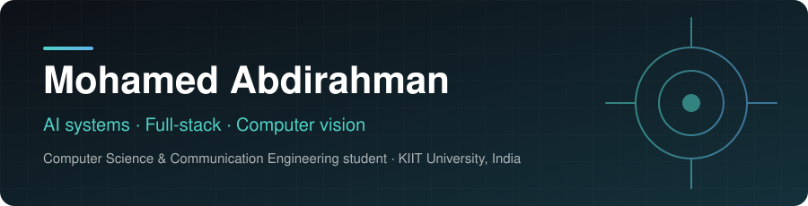
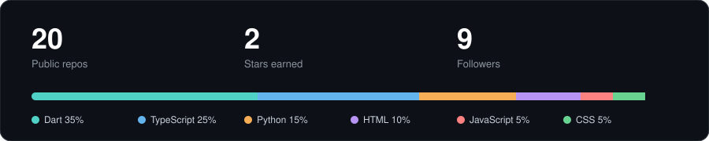

  

  
  
  
  

## About

I build AI-assisted software: computer-vision pipelines, security tools, and full-stack products. I like taking a real problem, understanding the system behind it, and shipping a working version. Python and TypeScript on most projects, FastAPI or Flask on the backend, React on the front.

Based in India, studying at **KIIT University**. Working toward becoming an **AI Systems Engineer**.

## Currently

|   | Role | What it is |
|:--|:-----|:-----------|
| 🎓 | **B.Tech Student**, KIIT University | Computer Science & Communication Engineering |
| 🟢 | **Founder**, HIRGAL | A technology community making AI, coding, and digital safety more accessible |
| 🛠️ | **Building** | AI vision pipelines, agent workflows, and secure backend systems |

## Selected work

| Project | What it does | Built with | Links |
|:--------|:-------------|:-----------|:------|
| **EdgePilot AI** | Browser-based safety-monitoring prototype. Samples webcam frames or uploads, uses Gemini Vision to detect safety events, scores risk with a deterministic rules engine, and uses Groq to write operator explanations and actions. Built at the AI Infra Summit Hackathon 2026. | `Python` `FastAPI` `Gemini` `Groq` `React` `TypeScript` | [Demo](https://edgepilot-ai-wk15.vercel.app/) · [Code](https://github.com/ODAY8/edgepilot-ai) |
| **PhishGuard** | Phishing detection and awareness platform. Scans emails (ML + rule-based scoring) and URLs (HTTPS, domain-age, WHOIS signals), with role-based access, a stats dashboard, awareness tips, and PDF reports. | `Python` `Flask` `SQLite` `ML` | [Code](https://github.com/ODAY8/Intelligent-Phishing-Detection-Awareness-Platform) |
<!-- TODO: add EverKeep, HandOver, FoodRescue rows after each repo is verified -->

## Stack

## The numbers

Generated daily from the GitHub API by Actions and committed to this repo.

## Contribution snake

  <picture>
    <source media="(prefers-color-scheme: dark)" srcset="https://raw.githubusercontent.com/ODAY8/ODAY8/output/snake-dark.svg">
    
  </picture>

### Building something with AI, software, or security?

**zapiryre@gmail.com** · [LinkedIn](https://www.linkedin.com/in/mohamed-abdirahman-warsame/) · [Portfolio](https://mohamedabdirahman.dev/)

Open to software engineering, AI, full-stack, and collaborative opportunities.
